# Etapa 3 — Diagrama Entidad-Relación (DER)

## Convenciones de nomenclatura

- **Modelos**: singular (ej. `Entidad`, `Trabajador`, `Escolaridad`, `Pais`, `CategoriaDoc`).
- **Tablas**: nombre del modelo + `-s` al final del nombre completo (ej. `entidads`, `escolaridads`, `paiss`, `categoria_docs`, `acceso_trabajadors`).
- **Columnas FK**: `<modelo_singular>_id` (ej. `trabajador_id`, `plaza_id`, `entidad_id`, `grado_mil_id`, `categoria_doc_id`).
- **Todas las tablas**: `id` BIGSERIAL PK, `created_at`, `updated_at`, `deleted_at` (soft delete).
- **Nomencladores globales**: `id`, `nombre`, `descripcion`, `observacion`, `timestamps`, `softDeletes`.
- **Pivotes M:M**: `id`, FKs, `timestamps`, `softDeletes`, UNIQUE compuesta del par.

---

## 1. Inventario de entidades

### Maestras y transaccionales
- `entidads`, `plazas`, `trabajadors`, `verificadors`, `cuentas`, `rols`.

### Historiales (con `fecha_inicio` / `fecha_fin`)
- `ocupacions` (trabajador ↔ plaza)
- `adscripcions` (verificador ↔ entidad)

### Hijas del trabajador
- `delitos`, `convivientes`, `extranjeros`, `sancionados`, `academicos`, `cientificos`.

### Nomencladores globales
- `grado_mils`, `accesos`, `militancias`, `organizacions`, `limitacions`, `parentescos`, `paiss`, `escolaridads`, `categoria_docs`, `categoria_ciens`, `categoria_trops`, `categoria_acads`, `grado_acads`, `grado_ciens`.

### Pivotes M:M
- `acceso_trabajadors`, `militancia_trabajadors`, `organizacion_trabajadors`, `limitacion_trabajadors`
- `militancia_convivientes`, `organizacion_convivientes`
- `rol_trabajadors`

---

## 2. Fichas de tablas

### 2.1 `entidads`
| Campo | Tipo | Restricciones |
|---|---|---|
| `id` | BIGSERIAL | PK |
| `numero` | VARCHAR(4) | NULL; UNIQUE cuando no es NULL |
| `nombre` | VARCHAR | NOT NULL; UNIQUE |
| `abreviatura` | VARCHAR(50) | NOT NULL; UNIQUE |
| `entidad_mayor` | INTEGER | NOT NULL; `0` = raíz; sin FK |
| `observacion` | VARCHAR | NOT NULL |
| `created_at`, `updated_at` | TIMESTAMPS | NOT NULL |
| `deleted_at` | TIMESTAMP | NULL (soft delete) |

> Jerarquía padre-hijo lógica; validación de ciclos en la capa de aplicación.

### 2.2 `plazas`
| Campo | Tipo | Restricciones |
|---|---|---|
| `id` | BIGSERIAL | PK |
| `nombre` | VARCHAR | NOT NULL |
| `entidad_id` | BIGINT | NOT NULL; FK `entidads.id` |
| `observacion` | VARCHAR | NOT NULL |
| `created_at`, `updated_at` | TIMESTAMPS | NOT NULL |
| `deleted_at` | TIMESTAMP | NULL |

> UNIQUE (`nombre`, `entidad_id`). Sin campo `estado` (se deriva de `ocupacions`).

### 2.3 `trabajadors`
| Campo | Tipo | Restricciones |
|---|---|---|
| `id` | BIGSERIAL | PK |
| `grado_mil_id` | BIGINT | NOT NULL; FK `grado_mils.id` |
| `primer_nombre` | VARCHAR | NOT NULL |
| `segundo_nombre` | VARCHAR | NULL |
| `primer_apellido` | VARCHAR | NOT NULL |
| `segundo_apellido` | VARCHAR | NOT NULL |
| `natural_de` | VARCHAR | NOT NULL |
| `carne` | VARCHAR(11) | NOT NULL; UNIQUE global (app) |
| `expediente` | VARCHAR(6) | NULL; UNIQUE global (app) |
| `direccion_particular` | VARCHAR | NOT NULL |
| `direccion_residencia` | VARCHAR | NOT NULL |
| `motivos` | TEXT | NOT NULL |
| `disposicion_extranjero` | BOOLEAN | NOT NULL |
| `criterio` | TEXT | NOT NULL |
| `juramento` | TEXT | NOT NULL |
| `objetado` | BOOLEAN | NULL |
| `escolaridad_id` | BIGINT | NOT NULL; FK `escolaridads.id` |
| `categoria_doc_id` | BIGINT | NULL; FK `categoria_docs.id` |
| `categoria_cien_id` | BIGINT | NULL; FK `categoria_ciens.id` |
| `categoria_trop_id` | BIGINT | NULL; FK `categoria_trops.id` |
| `categoria_acad_id` | BIGINT | NULL; FK `categoria_acads.id` |
| `registrador_id` | BIGINT | NOT NULL; FK `trabajadors.id` |
| `fecha_captacion` | DATE | NOT NULL |
| `verificador_id` | BIGINT | NULL; FK `verificadors.id` |
| `fecha_verificacion` | DATE | NULL |
| `aprobador_id` | BIGINT | NULL; FK `trabajadors.id` |
| `fecha_aprobacion` | DATE | NULL |
| `created_at`, `updated_at` | TIMESTAMPS | NOT NULL |
| `deleted_at` | TIMESTAMP | NULL |

> Sin `entidad_id`: la entidad se obtiene de la plaza activa en `ocupacions`.

### 2.4 `verificadors`
| Campo | Tipo | Restricciones |
|---|---|---|
| `id` | BIGSERIAL | PK |
| `grado_mil_id` | BIGINT | NOT NULL; FK `grado_mils.id` |
| `primer_nombre` | VARCHAR | NOT NULL |
| `segundo_nombre` | VARCHAR | NULL |
| `primer_apellido` | VARCHAR | NOT NULL |
| `segundo_apellido` | VARCHAR | NOT NULL |
| `carne` | VARCHAR(11) | NOT NULL; UNIQUE global (app) |
| `expediente` | VARCHAR(6) | NULL; UNIQUE global (app) |
| `created_at`, `updated_at` | TIMESTAMPS | NOT NULL |
| `deleted_at` | TIMESTAMP | NULL |

### 2.5 `cuentas`
| Campo | Tipo | Restricciones |
|---|---|---|
| `id` | BIGSERIAL | PK |
| `trabajador_id` | BIGINT | NOT NULL; UNIQUE; FK `trabajadors.id` (1:1) |
| `usuario` | VARCHAR | NOT NULL; UNIQUE |
| `password` | VARCHAR | NOT NULL |
| `created_at`, `updated_at` | TIMESTAMPS | NOT NULL |
| `deleted_at` | TIMESTAMP | NULL |

### 2.6 `rols`
| Campo | Tipo | Restricciones |
|---|---|---|
| `id` | BIGSERIAL | PK |
| `nombre` | VARCHAR | NOT NULL; UNIQUE |
| `descripcion` | VARCHAR | NOT NULL |
| `observacion` | VARCHAR | NOT NULL |
| `created_at`, `updated_at` | TIMESTAMPS | NOT NULL |
| `deleted_at` | TIMESTAMP | NULL |

> Catálogo inicial: Registrador, Aprobador, Administrador Local, Administrador Global, Visualizador, Trabajador.

### 2.7 `ocupacions` (historial trabajador ↔ plaza)
| Campo | Tipo | Restricciones |
|---|---|---|
| `id` | BIGSERIAL | PK |
| `trabajador_id` | BIGINT | NOT NULL; FK `trabajadors.id` |
| `plaza_id` | BIGINT | NOT NULL; FK `plazas.id` |
| `fecha_inicio` | DATE | NOT NULL |
| `fecha_fin` | DATE | NULL (NULL = ocupación actual) |
| `created_at`, `updated_at` | TIMESTAMPS | NOT NULL |
| `deleted_at` | TIMESTAMP | NULL |

> Reglas en aplicación: no puede haber dos filas con `fecha_fin = NULL` para el mismo `trabajador_id` ni para el mismo `plaza_id`.

### 2.8 `adscripcions` (historial verificador ↔ entidad)
| Campo | Tipo | Restricciones |
|---|---|---|
| `id` | BIGSERIAL | PK |
| `verificador_id` | BIGINT | NOT NULL; FK `verificadors.id` |
| `entidad_id` | BIGINT | NOT NULL; FK `entidads.id` |
| `fecha_inicio` | DATE | NOT NULL |
| `fecha_fin` | DATE | NULL (NULL = adscripción activa) |
| `created_at`, `updated_at` | TIMESTAMPS | NOT NULL |
| `deleted_at` | TIMESTAMP | NULL |

> Regla en aplicación: un verificador solo puede tener una adscripción activa a la vez.

### 2.9 `delitos`
| Campo | Tipo | Restricciones |
|---|---|---|
| `id` | BIGSERIAL | PK |
| `trabajador_id` | BIGINT | NOT NULL; FK `trabajadors.id` |
| `nombre` | VARCHAR | NOT NULL |
| `sancion` | TEXT | NOT NULL |
| `fecha` | DATE | NOT NULL |
| `created_at`, `updated_at` | TIMESTAMPS | NOT NULL |
| `deleted_at` | TIMESTAMP | NULL |

### 2.10 `convivientes`
| Campo | Tipo | Restricciones |
|---|---|---|
| `id` | BIGSERIAL | PK |
| `trabajador_id` | BIGINT | NOT NULL; FK `trabajadors.id` |
| `nombres_apellidos` | VARCHAR | NOT NULL |
| `parentesco_id` | BIGINT | NOT NULL; FK `parentescos.id` |
| `centro_trabajo` | VARCHAR | NOT NULL |
| `plaza` | VARCHAR | NOT NULL (texto libre) |
| `created_at`, `updated_at` | TIMESTAMPS | NOT NULL |
| `deleted_at` | TIMESTAMP | NULL |

### 2.11 `extranjeros`
| Campo | Tipo | Restricciones |
|---|---|---|
| `id` | BIGSERIAL | PK |
| `trabajador_id` | BIGINT | NOT NULL; FK `trabajadors.id` |
| `nombres_apellidos` | VARCHAR | NULL |
| `parentesco_id` | BIGINT | NOT NULL; FK `parentescos.id` |
| `pais_id` | BIGINT | NOT NULL; FK `paiss.id` |
| `mantiene_relacion` | BOOLEAN | NOT NULL |
| `created_at`, `updated_at` | TIMESTAMPS | NOT NULL |
| `deleted_at` | TIMESTAMP | NULL |

### 2.12 `sancionados`
| Campo | Tipo | Restricciones |
|---|---|---|
| `id` | BIGSERIAL | PK |
| `trabajador_id` | BIGINT | NOT NULL; FK `trabajadors.id` |
| `nombres_apellidos` | VARCHAR | NULL |
| `parentesco_id` | BIGINT | NOT NULL; FK `parentescos.id` |
| `delito` | TEXT | NOT NULL |
| `sancion` | TEXT | NULL |
| `created_at`, `updated_at` | TIMESTAMPS | NOT NULL |
| `deleted_at` | TIMESTAMP | NULL |

### 2.13 `academicos` (trabajador ↔ grado_acad con título)
| Campo | Tipo | Restricciones |
|---|---|---|
| `id` | BIGSERIAL | PK |
| `trabajador_id` | BIGINT | NOT NULL; FK `trabajadors.id` |
| `grado_acad_id` | BIGINT | NOT NULL; FK `grado_acads.id` |
| `titulo` | VARCHAR | NOT NULL |
| `created_at`, `updated_at` | TIMESTAMPS | NOT NULL |
| `deleted_at` | TIMESTAMP | NULL |

### 2.14 `cientificos` (trabajador ↔ grado_cien con título)
| Campo | Tipo | Restricciones |
|---|---|---|
| `id` | BIGSERIAL | PK |
| `trabajador_id` | BIGINT | NOT NULL; FK `trabajadors.id` |
| `grado_cien_id` | BIGINT | NOT NULL; FK `grado_ciens.id` |
| `titulo` | VARCHAR | NOT NULL |
| `created_at`, `updated_at` | TIMESTAMPS | NOT NULL |
| `deleted_at` | TIMESTAMP | NULL |

### 2.15 Pivotes M:M
Estructura uniforme: `id`, `<entidad>_id` (FK), `<otra>_id` (FK), `timestamps`, `softDeletes`, con UNIQUE compuesta sobre el par.

- `acceso_trabajadors(trabajador_id, acceso_id)`
- `militancia_trabajadors(trabajador_id, militancia_id)`
- `organizacion_trabajadors(trabajador_id, organizacion_id)`
- `limitacion_trabajadors(trabajador_id, limitacion_id)`
- `militancia_convivientes(conviviente_id, militancia_id)`
- `organizacion_convivientes(conviviente_id, organizacion_id)`
- `rol_trabajadors(trabajador_id, rol_id)`

### 2.16 Nomencladores globales (estructura común)
`id`, `nombre`, `descripcion`, `observacion`, `created_at`, `updated_at`, `deleted_at`.

`grado_mils` · `accesos` · `militancias` · `organizacions` · `limitacions` · `parentescos` · `paiss` · `escolaridads` · `categoria_docs` · `categoria_ciens` · `categoria_trops` · `categoria_acads` · `grado_acads` · `grado_ciens`.

---

## 3. Diagrama ER

```mermaid
erDiagram
    ENTIDAD {
        bigint id PK
        string numero UK "NULL; 4 digitos"
        string nombre UK
        string abreviatura UK "max 50"
        int entidad_mayor "0=raiz; sin FK"
        string observacion
        timestamp created_at
        timestamp updated_at
        timestamp deleted_at
    }

    PLAZA {
        bigint id PK
        string nombre
        bigint entidad_id FK
        string observacion
        timestamp created_at
        timestamp updated_at
        timestamp deleted_at
    }

    TRABAJADOR {
        bigint id PK
        bigint grado_mil_id FK
        string primer_nombre
        string segundo_nombre "NULL"
        string primer_apellido
        string segundo_apellido
        string natural_de
        string carne UK "11; unicidad global app"
        string expediente UK "NULL; 6; unicidad global app"
        string direccion_particular
        string direccion_residencia
        text motivos
        boolean disposicion_extranjero
        text criterio
        text juramento
        boolean objetado "NULL"
        bigint escolaridad_id FK
        bigint categoria_doc_id FK "NULL"
        bigint categoria_cien_id FK "NULL"
        bigint categoria_trop_id FK "NULL"
        bigint categoria_acad_id FK "NULL"
        bigint registrador_id FK
        date fecha_captacion
        bigint verificador_id FK "NULL"
        date fecha_verificacion "NULL"
        bigint aprobador_id FK "NULL"
        date fecha_aprobacion "NULL"
        timestamp created_at
        timestamp updated_at
        timestamp deleted_at
    }

    VERIFICADOR {
        bigint id PK
        bigint grado_mil_id FK
        string primer_nombre
        string segundo_nombre "NULL"
        string primer_apellido
        string segundo_apellido
        string carne UK "11; unicidad global app"
        string expediente UK "NULL; 6; unicidad global app"
        timestamp created_at
        timestamp updated_at
        timestamp deleted_at
    }

    CUENTA {
        bigint id PK
        bigint trabajador_id FK "UNIQUE; 1:1"
        string usuario UK
        string password
        timestamp created_at
        timestamp updated_at
        timestamp deleted_at
    }

    ROL {
        bigint id PK
        string nombre UK
        string descripcion
        string observacion
        timestamp created_at
        timestamp updated_at
        timestamp deleted_at
    }

    OCUPACION {
        bigint id PK
        bigint trabajador_id FK
        bigint plaza_id FK
        date fecha_inicio
        date fecha_fin "NULL = actual"
        timestamp created_at
        timestamp updated_at
        timestamp deleted_at
    }

    ADSCRIPCION {
        bigint id PK
        bigint verificador_id FK
        bigint entidad_id FK
        date fecha_inicio
        date fecha_fin "NULL = activa"
        timestamp created_at
        timestamp updated_at
        timestamp deleted_at
    }

    DELITO {
        bigint id PK
        bigint trabajador_id FK
        string nombre
        text sancion
        date fecha
        timestamp created_at
        timestamp updated_at
        timestamp deleted_at
    }

    CONVIVIENTE {
        bigint id PK
        bigint trabajador_id FK
        string nombres_apellidos
        bigint parentesco_id FK
        string centro_trabajo
        string plaza
        timestamp created_at
        timestamp updated_at
        timestamp deleted_at
    }

    EXTRANJERO {
        bigint id PK
        bigint trabajador_id FK
        string nombres_apellidos "NULL"
        bigint parentesco_id FK
        bigint pais_id FK
        boolean mantiene_relacion
        timestamp created_at
        timestamp updated_at
        timestamp deleted_at
    }

    SANCIONADO {
        bigint id PK
        bigint trabajador_id FK
        string nombres_apellidos "NULL"
        bigint parentesco_id FK
        text delito
        text sancion "NULL"
        timestamp created_at
        timestamp updated_at
        timestamp deleted_at
    }

    ACADEMICO {
        bigint id PK
        bigint trabajador_id FK
        bigint grado_acad_id FK
        string titulo
        timestamp created_at
        timestamp updated_at
        timestamp deleted_at
    }

    CIENTIFICO {
        bigint id PK
        bigint trabajador_id FK
        bigint grado_cien_id FK
        string titulo
        timestamp created_at
        timestamp updated_at
        timestamp deleted_at
    }

    GRADO_MIL { bigint id PK  string nombre  string descripcion  string observacion }
    ACCESO { bigint id PK  string nombre  string descripcion  string observacion }
    MILITANCIA { bigint id PK  string nombre  string descripcion  string observacion }
    ORGANIZACION { bigint id PK  string nombre  string descripcion  string observacion }
    LIMITACION { bigint id PK  string nombre  string descripcion  string observacion }
    PARENTESCO { bigint id PK  string nombre  string descripcion  string observacion }
    PAIS { bigint id PK  string nombre  string descripcion  string observacion }
    ESCOLARIDAD { bigint id PK  string nombre  string descripcion  string observacion }
    CATEGORIA_DOC { bigint id PK  string nombre  string descripcion  string observacion }
    CATEGORIA_CIEN { bigint id PK  string nombre  string descripcion  string observacion }
    CATEGORIA_TROP { bigint id PK  string nombre  string descripcion  string observacion }
    CATEGORIA_ACAD { bigint id PK  string nombre  string descripcion  string observacion }
    GRADO_ACAD { bigint id PK  string nombre  string descripcion  string observacion }
    GRADO_CIEN { bigint id PK  string nombre  string descripcion  string observacion }

    ENTIDAD ||--o{ ENTIDAD : "entidad_mayor (logica)"
    ENTIDAD ||--o{ PLAZA : "tiene"
    TRABAJADOR ||--o| CUENTA : "1:1"
    TRABAJADOR }o--|| GRADO_MIL : "grado_mil"
    TRABAJADOR }o--|| ESCOLARIDAD : "escolaridad"
    TRABAJADOR }o--o| CATEGORIA_DOC : "categoria_doc"
    TRABAJADOR }o--o| CATEGORIA_CIEN : "categoria_cien"
    TRABAJADOR }o--o| CATEGORIA_TROP : "categoria_trop"
    TRABAJADOR }o--o| CATEGORIA_ACAD : "categoria_acad"
    TRABAJADOR ||--o{ OCUPACION : "historial"
    PLAZA ||--o{ OCUPACION : "historial"
    TRABAJADOR ||--o{ DELITO : "tiene"
    TRABAJADOR ||--o{ CONVIVIENTE : "tiene"
    TRABAJADOR ||--o{ EXTRANJERO : "tiene"
    TRABAJADOR ||--o{ SANCIONADO : "tiene"
    TRABAJADOR ||--o{ ACADEMICO : "tiene"
    TRABAJADOR ||--o{ CIENTIFICO : "tiene"
    TRABAJADOR }o--o{ ACCESO : "acceso_trabajadors"
    TRABAJADOR }o--o{ MILITANCIA : "militancia_trabajadors"
    TRABAJADOR }o--o{ ORGANIZACION : "organizacion_trabajadors"
    TRABAJADOR }o--o{ LIMITACION : "limitacion_trabajadors"
    TRABAJADOR }o--o{ ROL : "rol_trabajadors"
    CONVIVIENTE }o--o{ MILITANCIA : "militancia_convivientes"
    CONVIVIENTE }o--o{ ORGANIZACION : "organizacion_convivientes"
    CONVIVIENTE }o--|| PARENTESCO : "parentesco"
    EXTRANJERO }o--|| PARENTESCO : "parentesco"
    EXTRANJERO }o--|| PAIS : "pais"
    SANCIONADO }o--|| PARENTESCO : "parentesco"
    ACADEMICO }o--|| GRADO_ACAD : "grado"
    CIENTIFICO }o--|| GRADO_CIEN : "grado"
    VERIFICADOR }o--|| GRADO_MIL : "grado_mil"
    VERIFICADOR ||--o{ ADSCRIPCION : "historial"
    ENTIDAD ||--o{ ADSCRIPCION : "historial"
    TRABAJADOR }o--o| VERIFICADOR : "verificador"
    TRABAJADOR }o--o| TRABAJADOR : "registrador"
    TRABAJADOR }o--o| TRABAJADOR : "aprobador"
```

> En el `erDiagram` las entidades se muestran en singular (nombre del modelo) por convención Mermaid; las tablas físicas llevan la `-s` final indicada en las fichas.

---

## 4. Notas de decisiones clave

1. **`entidad_mayor` sin FK**: entero obligatorio; `0` marca la raíz. Integridad jerárquica y ausencia de ciclos validadas en aplicación.
2. **Entidad del trabajador derivada**: sin `entidad_id` en `trabajadors`; se obtiene de `ocupacions` con `fecha_fin IS NULL`.
3. **Estado de plaza derivado**: `plazas` no almacena `estado`; se calcula con `EXISTS(ocupacions WHERE fecha_fin IS NULL)`.
4. **Unicidad global de `carne` y `expediente`**: UNIQUE en cada tabla + validación cruzada en Lumen (`trabajadors` ∪ `verificadors`).
5. **Registrador y aprobador** son FKs auto-referenciadas a `trabajadors`; **verificador** es FK a `verificadors` (no accede al sistema).
6. **Nomencladores globales** comparten estructura (`nombre`, `descripcion`, `observacion`, timestamps, soft delete).
7. **Historiales `ocupacions` y `adscripcions`**: `fecha_fin = NULL` denota registro actual/activo. Las reglas de “solo un activo por trabajador/plaza/verificador” se aplican en la capa de aplicación.
8. **Regla estricta de nomenclatura**: tablas = nombre del modelo + `-s` al final del nombre completo (ej. `paiss`, `escolaridads`, `categoria_docs`, `acceso_trabajadors`). Columnas FK en singular + `_id`.
9. **Todos los pivotes M:M** con `id`, `timestamps`, `softDeletes` y UNIQUE compuesta sobre el par.
10. **Roles**: catálogo `rols` con M:M hacia `trabajadors` vía `rol_trabajadors`.