# Etapa 4 — Diagrama de tablas de la BD

Diagrama físico de tablas para PostgreSQL 14, derivado del DER de la Etapa 3.

## Convenciones aplicadas

- **Motor**: PostgreSQL 14.
- **PK**: `BIGSERIAL`.
- **FK**: `BIGINT`, `ON DELETE RESTRICT` salvo indicación contraria.
- **Soft delete**: `deleted_at TIMESTAMP NULL`.
- **Timestamps**: `created_at`, `updated_at` `TIMESTAMP NOT NULL DEFAULT now()`.
- **Nomencladores**: `nombre`, `descripcion`, `observacion` `VARCHAR NOT NULL`.
- **Unicidades globales de `carne` y `expediente`** (trabajadors ∪ verificadors): validación en aplicación; en BD solo `UNIQUE` local por tabla.
- **Reglas “solo un activo”** en `ocupacions` y `adscripcions`: validación en aplicación.
- **`entidad_mayor`**: `INTEGER NOT NULL`, sin FK; `0` = raíz.
- **Regla estricta de nomenclatura**: tablas = nombre del modelo + `-s` al final del nombre completo; columnas FK en singular + `_id`.

---

## 1. `entidads`

| Columna | Tipo | Nulo | Default | Restricción |
|---|---|---|---|---|
| `id` | BIGSERIAL | No | — | PK |
| `numero` | VARCHAR(4) | Sí | NULL | UNIQUE parcial (WHERE numero IS NOT NULL) |
| `nombre` | VARCHAR(255) | No | — | UNIQUE |
| `abreviatura` | VARCHAR(50) | No | — | UNIQUE |
| `entidad_mayor` | INTEGER | No | — | CHECK (entidad_mayor >= 0) |
| `observacion` | VARCHAR(255) | No | — | — |
| `created_at` | TIMESTAMP | No | now() | — |
| `updated_at` | TIMESTAMP | No | now() | — |
| `deleted_at` | TIMESTAMP | Sí | NULL | — |

**Índices**: `entidads_numero_unique` (parcial), `entidads_nombre_unique`, `entidads_abreviatura_unique`, `entidads_entidad_mayor_idx`.

---

## 2. `plazas`

| Columna | Tipo | Nulo | Default | Restricción |
|---|---|---|---|---|
| `id` | BIGSERIAL | No | — | PK |
| `nombre` | VARCHAR(255) | No | — | — |
| `entidad_id` | BIGINT | No | — | FK → `entidads.id` |
| `observacion` | VARCHAR(255) | No | — | — |
| `created_at` | TIMESTAMP | No | now() | — |
| `updated_at` | TIMESTAMP | No | now() | — |
| `deleted_at` | TIMESTAMP | Sí | NULL | — |

**Índices**: `plazas_nombre_entidad_id_unique` (UNIQUE compuesta).

---

## 3. `grado_mils` (nomenclador)

| Columna | Tipo | Nulo | Default | Restricción |
|---|---|---|---|---|
| `id` | BIGSERIAL | No | — | PK |
| `nombre` | VARCHAR(255) | No | — | UNIQUE |
| `descripcion` | VARCHAR(255) | No | — | — |
| `observacion` | VARCHAR(255) | No | — | — |
| `created_at`, `updated_at` | TIMESTAMP | No | now() | — |
| `deleted_at` | TIMESTAMP | Sí | NULL | — |

---

## 4. `escolaridads` (nomenclador)

Misma estructura que `grado_mils`.

---

## 5. `categoria_docs` (nomenclador)

Misma estructura que `grado_mils`.

---

## 6. `categoria_ciens` (nomenclador)

Misma estructura que `grado_mils`.

---

## 7. `categoria_trops` (nomenclador)

Misma estructura que `grado_mils`.

---

## 8. `categoria_acads` (nomenclador)

Misma estructura que `grado_mils`.

---

## 9. `grado_acads` (nomenclador)

Misma estructura que `grado_mils`.

---

## 10. `grado_ciens` (nomenclador)

Misma estructura que `grado_mils`.

---

## 11. `accesos` (nomenclador)

Misma estructura que `grado_mils`.

---

## 12. `militancias` (nomenclador)

Misma estructura que `grado_mils`.

---

## 13. `organizacions` (nomenclador)

Misma estructura que `grado_mils`.

---

## 14. `limitacions` (nomenclador)

Misma estructura que `grado_mils`.

---

## 15. `parentescos` (nomenclador)

Misma estructura que `grado_mils`.

---

## 16. `paiss` (nomenclador)

Misma estructura que `grado_mils`.

---

## 17. `trabajadors`

| Columna | Tipo | Nulo | Default | Restricción |
|---|---|---|---|---|
| `id` | BIGSERIAL | No | — | PK |
| `grado_mil_id` | BIGINT | No | — | FK → `grado_mils.id` |
| `primer_nombre` | VARCHAR(255) | No | — | — |
| `segundo_nombre` | VARCHAR(255) | Sí | NULL | — |
| `primer_apellido` | VARCHAR(255) | No | — | — |
| `segundo_apellido` | VARCHAR(255) | No | — | — |
| `natural_de` | VARCHAR(255) | No | — | — |
| `carne` | VARCHAR(11) | No | — | UNIQUE; CHECK (char_length(carne)=11) |
| `expediente` | VARCHAR(6) | Sí | NULL | UNIQUE; CHECK (expediente IS NULL OR char_length(expediente)=6) |
| `direccion_particular` | VARCHAR(255) | No | — | — |
| `direccion_residencia` | VARCHAR(255) | No | — | — |
| `motivos` | TEXT | No | — | — |
| `disposicion_extranjero` | BOOLEAN | No | — | — |
| `criterio` | TEXT | No | — | — |
| `juramento` | TEXT | No | — | — |
| `objetado` | BOOLEAN | Sí | NULL | — |
| `escolaridad_id` | BIGINT | No | — | FK → `escolaridads.id` |
| `categoria_doc_id` | BIGINT | Sí | NULL | FK → `categoria_docs.id` |
| `categoria_cien_id` | BIGINT | Sí | NULL | FK → `categoria_ciens.id` |
| `categoria_trop_id` | BIGINT | Sí | NULL | FK → `categoria_trops.id` |
| `categoria_acad_id` | BIGINT | Sí | NULL | FK → `categoria_acads.id` |
| `registrador_id` | BIGINT | No | — | FK → `trabajadors.id` |
| `fecha_captacion` | DATE | No | — | — |
| `verificador_id` | BIGINT | Sí | NULL | FK → `verificadors.id` |
| `fecha_verificacion` | DATE | Sí | NULL | — |
| `aprobador_id` | BIGINT | Sí | NULL | FK → `trabajadors.id` |
| `fecha_aprobacion` | DATE | Sí | NULL | — |
| `created_at`, `updated_at` | TIMESTAMP | No | now() | — |
| `deleted_at` | TIMESTAMP | Sí | NULL | — |

**Índices**: `trabajadors_carne_unique`, `trabajadors_expediente_unique`, `trabajadors_registrador_id_idx`, `trabajadors_aprobador_id_idx`, `trabajadors_verificador_id_idx`.

---

## 18. `verificadors`

| Columna | Tipo | Nulo | Default | Restricción |
|---|---|---|---|---|
| `id` | BIGSERIAL | No | — | PK |
| `grado_mil_id` | BIGINT | No | — | FK → `grado_mils.id` |
| `primer_nombre` | VARCHAR(255) | No | — | — |
| `segundo_nombre` | VARCHAR(255) | Sí | NULL | — |
| `primer_apellido` | VARCHAR(255) | No | — | — |
| `segundo_apellido` | VARCHAR(255) | No | — | — |
| `carne` | VARCHAR(11) | No | — | UNIQUE; CHECK (char_length(carne)=11) |
| `expediente` | VARCHAR(6) | Sí | NULL | UNIQUE; CHECK (expediente IS NULL OR char_length(expediente)=6) |
| `created_at`, `updated_at` | TIMESTAMP | No | now() | — |
| `deleted_at` | TIMESTAMP | Sí | NULL | — |

---

## 19. `cuentas`

| Columna | Tipo | Nulo | Default | Restricción |
|---|---|---|---|---|
| `id` | BIGSERIAL | No | — | PK |
| `trabajador_id` | BIGINT | No | — | UNIQUE; FK → `trabajadors.id` |
| `usuario` | VARCHAR(255) | No | — | UNIQUE |
| `password` | VARCHAR(255) | No | — | — |
| `created_at`, `updated_at` | TIMESTAMP | No | now() | — |
| `deleted_at` | TIMESTAMP | Sí | NULL | — |

---

## 20. `rols`

| Columna | Tipo | Nulo | Default | Restricción |
|---|---|---|---|---|
| `id` | BIGSERIAL | No | — | PK |
| `nombre` | VARCHAR(255) | No | — | UNIQUE |
| `descripcion` | VARCHAR(255) | No | — | — |
| `observacion` | VARCHAR(255) | No | — | — |
| `created_at`, `updated_at` | TIMESTAMP | No | now() | — |
| `deleted_at` | TIMESTAMP | Sí | NULL | — |

> Catálogo inicial: Registrador, Aprobador, Administrador Local, Administrador Global, Visualizador, Trabajador.

---

## 21. `ocupacions`

| Columna | Tipo | Nulo | Default | Restricción |
|---|---|---|---|---|
| `id` | BIGSERIAL | No | — | PK |
| `trabajador_id` | BIGINT | No | — | FK → `trabajadors.id` |
| `plaza_id` | BIGINT | No | — | FK → `plazas.id` |
| `fecha_inicio` | DATE | No | — | — |
| `fecha_fin` | DATE | Sí | NULL | CHECK (fecha_fin IS NULL OR fecha_fin >= fecha_inicio) |
| `created_at`, `updated_at` | TIMESTAMP | No | now() | — |
| `deleted_at` | TIMESTAMP | Sí | NULL | — |

**Índices**: `ocupacions_trabajador_id_idx`, `ocupacions_plaza_id_idx`, `ocupacions_trabajador_activa_idx` (WHERE fecha_fin IS NULL), `ocupacions_plaza_activa_idx` (WHERE fecha_fin IS NULL).

---

## 22. `adscripcions`

| Columna | Tipo | Nulo | Default | Restricción |
|---|---|---|---|---|
| `id` | BIGSERIAL | No | — | PK |
| `verificador_id` | BIGINT | No | — | FK → `verificadors.id` |
| `entidad_id` | BIGINT | No | — | FK → `entidads.id` |
| `fecha_inicio` | DATE | No | — | — |
| `fecha_fin` | DATE | Sí | NULL | CHECK (fecha_fin IS NULL OR fecha_fin >= fecha_inicio) |
| `created_at`, `updated_at` | TIMESTAMP | No | now() | — |
| `deleted_at` | TIMESTAMP | Sí | NULL | — |

**Índices**: `adscripcions_verificador_activa_idx` (WHERE fecha_fin IS NULL), `adscripcions_entidad_id_idx`.

---

## 23. `delitos`

| Columna | Tipo | Nulo | Default | Restricción |
|---|---|---|---|---|
| `id` | BIGSERIAL | No | — | PK |
| `trabajador_id` | BIGINT | No | — | FK → `trabajadors.id` |
| `nombre` | VARCHAR(255) | No | — | — |
| `sancion` | TEXT | No | — | — |
| `fecha` | DATE | No | — | — |
| `created_at`, `updated_at` | TIMESTAMP | No | now() | — |
| `deleted_at` | TIMESTAMP | Sí | NULL | — |

**Índices**: `delitos_trabajador_id_idx`.

---

## 24. `convivientes`

| Columna | Tipo | Nulo | Default | Restricción |
|---|---|---|---|---|
| `id` | BIGSERIAL | No | — | PK |
| `trabajador_id` | BIGINT | No | — | FK → `trabajadors.id` |
| `nombres_apellidos` | VARCHAR(255) | No | — | — |
| `parentesco_id` | BIGINT | No | — | FK → `parentescos.id` |
| `centro_trabajo` | VARCHAR(255) | No | — | — |
| `plaza` | VARCHAR(255) | No | — | — |
| `created_at`, `updated_at` | TIMESTAMP | No | now() | — |
| `deleted_at` | TIMESTAMP | Sí | NULL | — |

**Índices**: `convivientes_trabajador_id_idx`.

---

## 25. `extranjeros`

| Columna | Tipo | Nulo | Default | Restricción |
|---|---|---|---|---|
| `id` | BIGSERIAL | No | — | PK |
| `trabajador_id` | BIGINT | No | — | FK → `trabajadors.id` |
| `nombres_apellidos` | VARCHAR(255) | Sí | NULL | — |
| `parentesco_id` | BIGINT | No | — | FK → `parentescos.id` |
| `pais_id` | BIGINT | No | — | FK → `paiss.id` |
| `mantiene_relacion` | BOOLEAN | No | — | — |
| `created_at`, `updated_at` | TIMESTAMP | No | now() | — |
| `deleted_at` | TIMESTAMP | Sí | NULL | — |

**Índices**: `extranjeros_trabajador_id_idx`.

---

## 26. `sancionados`

| Columna | Tipo | Nulo | Default | Restricción |
|---|---|---|---|---|
| `id` | BIGSERIAL | No | — | PK |
| `trabajador_id` | BIGINT | No | — | FK → `trabajadors.id` |
| `nombres_apellidos` | VARCHAR(255) | Sí | NULL | — |
| `parentesco_id` | BIGINT | No | — | FK → `parentescos.id` |
| `delito` | TEXT | No | — | — |
| `sancion` | TEXT | Sí | NULL | — |
| `created_at`, `updated_at` | TIMESTAMP | No | now() | — |
| `deleted_at` | TIMESTAMP | Sí | NULL | — |

**Índices**: `sancionados_trabajador_id_idx`.

---

## 27. `academicos`

| Columna | Tipo | Nulo | Default | Restricción |
|---|---|---|---|---|
| `id` | BIGSERIAL | No | — | PK |
| `trabajador_id` | BIGINT | No | — | FK → `trabajadors.id` |
| `grado_acad_id` | BIGINT | No | — | FK → `grado_acads.id` |
| `titulo` | VARCHAR(255) | No | — | — |
| `created_at`, `updated_at` | TIMESTAMP | No | now() | — |
| `deleted_at` | TIMESTAMP | Sí | NULL | — |

**Índices**: `academicos_trabajador_id_idx`, `academicos_trabajador_grado_unique` (UNIQUE compuesta).

---

## 28. `cientificos`

| Columna | Tipo | Nulo | Default | Restricción |
|---|---|---|---|---|
| `id` | BIGSERIAL | No | — | PK |
| `trabajador_id` | BIGINT | No | — | FK → `trabajadors.id` |
| `grado_cien_id` | BIGINT | No | — | FK → `grado_ciens.id` |
| `titulo` | VARCHAR(255) | No | — | — |
| `created_at`, `updated_at` | TIMESTAMP | No | now() | — |
| `deleted_at` | TIMESTAMP | Sí | NULL | — |

**Índices**: `cientificos_trabajador_id_idx`, `cientificos_trabajador_grado_unique` (UNIQUE compuesta).

---

## 29. Pivotes M:M

### 29.1 `acceso_trabajadors`

| Columna | Tipo | Nulo | Restricción |
|---|---|---|---|
| `id` | BIGSERIAL | No | PK |
| `trabajador_id` | BIGINT | No | FK → `trabajadors.id` |
| `acceso_id` | BIGINT | No | FK → `accesos.id` |
| `created_at`, `updated_at` | TIMESTAMP | No | — |
| `deleted_at` | TIMESTAMP | Sí | — |

**Índices**: `acceso_trabajadors_unique (trabajador_id, acceso_id)`.

### 29.2 `militancia_trabajadors`

Estructura idéntica, FK → `militancias.id`. UNIQUE compuesta.

### 29.3 `organizacion_trabajadors`

Estructura idéntica, FK → `organizacions.id`. UNIQUE compuesta.

### 29.4 `limitacion_trabajadors`

Estructura idéntica, FK → `limitacions.id`. UNIQUE compuesta.

### 29.5 `militancia_convivientes`

| Columna | Tipo | Nulo | Restricción |
|---|---|---|---|
| `id` | BIGSERIAL | No | PK |
| `conviviente_id` | BIGINT | No | FK → `convivientes.id` |
| `militancia_id` | BIGINT | No | FK → `militancias.id` |
| `created_at`, `updated_at` | TIMESTAMP | No | — |
| `deleted_at` | TIMESTAMP | Sí | — |

**Índices**: `militancia_convivientes_unique (conviviente_id, militancia_id)`.

### 29.6 `organizacion_convivientes`

Estructura idéntica, FK → `organizacions.id`. UNIQUE compuesta.

### 29.7 `rol_trabajadors`

| Columna | Tipo | Nulo | Restricción |
|---|---|---|---|
| `id` | BIGSERIAL | No | PK |
| `trabajador_id` | BIGINT | No | FK → `trabajadors.id` |
| `rol_id` | BIGINT | No | FK → `rols.id` |
| `created_at`, `updated_at` | TIMESTAMP | No | — |
| `deleted_at` | TIMESTAMP | Sí | — |

**Índices**: `rol_trabajadors_unique (trabajador_id, rol_id)`.

---

## 30. Diagrama Mermaid de bloques por tabla

```mermaid
graph TB
    subgraph Entidades
        E[entidads<br/>id, numero, nombre, abreviatura,<br/>entidad_mayor, observacion, timestamps]
        P[plazas<br/>id, nombre, entidad_id, observacion, timestamps]
    end

    subgraph Personas
        T[trabajadors<br/>+ datos personales, categorías,<br/>registrador_id, verificador_id,<br/>aprobador_id, fechas, timestamps]
        V[verificadors<br/>datos personales, timestamps]
        C[cuentas<br/>trabajador_id, usuario, password, timestamps]
        R[rols<br/>nombre, descripcion, observacion, timestamps]
    end

    subgraph Historiales
        O[ocupacions<br/>trabajador_id, plaza_id,<br/>fecha_inicio, fecha_fin, timestamps]
        A[adscripcions<br/>verificador_id, entidad_id,<br/>fecha_inicio, fecha_fin, timestamps]
    end

    subgraph Familia_y_delitos
        D[delitos<br/>trabajador_id, nombre, sancion, fecha, timestamps]
        CO[convivientes<br/>trabajador_id, parentesco_id,<br/>centro_trabajo, plaza, timestamps]
        EX[extranjeros<br/>trabajador_id, parentesco_id,<br/>pais_id, mantiene_relacion, timestamps]
        SA[sancionados<br/>trabajador_id, parentesco_id,<br/>delito, sancion, timestamps]
    end

    subgraph Formacion
        AC[academicos<br/>trabajador_id, grado_acad_id,<br/>titulo, timestamps]
        CI[cientificos<br/>trabajador_id, grado_cien_id,<br/>titulo, timestamps]
    end

    subgraph Nomencladores
        GM[grado_mils]
        ES[escolaridads]
        CD[categoria_docs]
        CC[categoria_ciens]
        CT[categoria_trops]
        CA[categoria_acads]
        GA[grado_acads]
        GC[grado_ciens]
        AX[accesos]
        MI[militancias]
        OR[organizacions]
        LI[limitacions]
        PA[parentescos]
        PS[paiss]
    end

    subgraph Pivotes
        AT[acceso_trabajadors]
        MT[militancia_trabajadors]
        OT[organizacion_trabajadors]
        LT[limitacion_trabajadors]
        MC[militancia_convivientes]
        OC[organizacion_convivientes]
        RT[rol_trabajadors]
    end

    E --> P
    E --> A
    V --> A
    P --> O
    T --> O
    T --> C
    T --> D
    T --> CO
    T --> EX
    T --> SA
    T --> AC
    T --> CI
    T --> AT
    T --> MT
    T --> OT
    T --> LT
    T --> RT
    CO --> MC
    CO --> OC
    MI --> MT
    MI --> MC
    OR --> OT
    OR --> OC
    AX --> AT
    LI --> LT
    R --> RT
    PA --> CO
    PA --> EX
    PA --> SA
    PS --> EX
    GA --> AC
    GC --> CI
    GM --> T
    GM --> V
    ES --> T
    CD --> T
    CC --> T
    CT --> T
    CA --> T
    T --> V
    T --> T
```

---

## 31. Notas finales

1. **Índices únicos parciales** en `entidads.numero` y en columnas `carne`/`expediente` de `trabajadors` y `verificadors` para permitir múltiples `NULL`.
2. **Índices parciales** en `ocupacions` y `adscripcions` (`WHERE fecha_fin IS NULL`) para acelerar la consulta del registro activo.
3. **Restricción de unicidad global `carne`/`expediente`** entre `trabajadors` y `verificadors`: validación en Lumen.
4. **Regla “una sola ocupación activa por trabajador/plaza”** y **“una sola adscripción activa por verificador”**: validación en Lumen.
5. **Soft delete** en todas las tablas vía `deleted_at`.
6. **Catálogo `rols`** se poblará con: Registrador, Aprobador, Administrador Local, Administrador Global, Visualizador, Trabajador.
7. **`entidad_mayor`** sin FK y con `CHECK (entidad_mayor >= 0)`.